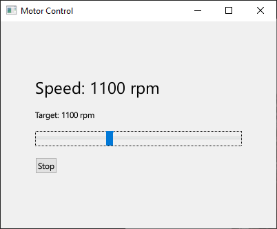

# Motor Control

A simulation application that drives a DC motor with a PID controller. Built with C++17 and Qt 6, with a QML interface.

## How it works
- **Motor** (`motor.h/.cpp`): a simple DC motor model. The speed moves toward "power * 3000 rpm" with a 0.5 s time constant.
- **PidController** (`pidcontroller.h/.cpp`): Calculates the motor power (0 to 1) from the error (target − speed). It uses PI control (Kp = 0.001, Ki = 0.002, Kd = 0) because with Kd the speed started to oscillate.
- **MotorController** (`motorcontroller.h/.cpp`): The bridge between C++ and QML (a QObject). A QTimer runs one control step every 100 ms.
- **Main.qml**: The slider sets the target speed, the button starts and stops the motor, and the label shows the current speed live.

## Build and run
Requirements: Qt 6.10+, CMake 3.16+, a C++17 compiler. Open CMakeLists.txt in Qt Creator, build, and run the motor-control target.

## Tests
Unit tests with Qt Test (tests/tst_pidcontroller.cpp): three checks of the PID output and one integration test where the motor reaches the target speed.

## Next steps
- Sliders to change Kp, Ki and Kd while the app is running
- A chart that shows the speed over time
